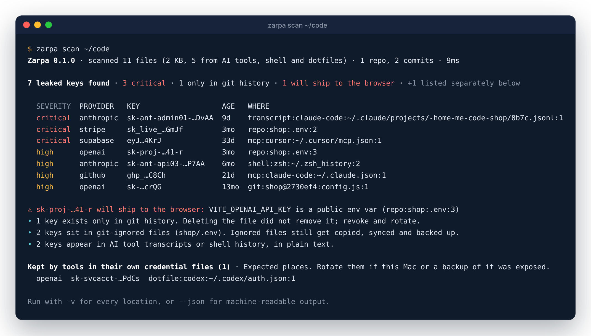

# Zarpa

**Find every API key on your machine, and see where each one leaked.**

AI coding tools copy keys into places nobody looks: chat transcripts, MCP
configs, shell history. Old keys live on in git history after you delete the
file. A `VITE_` variable quietly ships a secret to every visitor's browser.
Zarpa finds all of them with one command. It runs offline, and raw keys never
leave your machine.

[](https://github.com/Reetcodeio/zarpa/actions/workflows/ci.yml)
[](LICENSE)



<sub>Every key above is fake. Run `make demo` to see the same report on a throwaway fake machine.</sub>

## Install

```sh
# macOS (Apple Silicon and Intel) or Linux
brew install reetcodeio/tap/zarpa

# macOS or Linux: checks the SHA-256, and the cosign signature when cosign is installed
curl -fsSL https://raw.githubusercontent.com/Reetcodeio/zarpa/main/install.sh | sh

# Anywhere with Go 1.23+
go install github.com/Reetcodeio/zarpa/cmd/zarpa@latest
```

Windows: download the `.zip` from [Releases](https://github.com/Reetcodeio/zarpa/releases), or `scoop bucket add zarpa https://github.com/Reetcodeio/scoop-bucket` then `scoop install zarpa`.

Downloading the macOS archive in a browser? The binary isn't notarized by Apple yet, so macOS blocks it; use one of the commands above, or run `xattr -d com.apple.quarantine ./zarpa` after checking `checksums.txt`.

## Use

```sh
zarpa scan                 # this folder + AI tools, MCP configs, shell history, dotfiles
zarpa scan ~               # everything under your home folder
zarpa scan ~/code -v       # every location of every key
zarpa check ~              # then test which keys still work (asks first)
```

A full home-folder scan of a developer Mac (309,775 files, 24 repos, 18,162
commits) takes about a minute and a half.

## What it scans

- **Folders you name.** Honors `.gitignore`, but still scans ignored `.env*`, `.envrc`, `.npmrc` and MCP config files and marks them, because that is where forgotten keys live. Skips dependency caches (`node_modules`, `.venv`, …) and binaries.
- **Git history.** Every line ever added on every branch of every repo found. Each finding points at the commit that introduced the key, even if the file is long gone.
- **AI tools.** Session transcripts, logs and shell snapshots of Claude Code, Codex, Gemini CLI, Cursor, Continue and Codeium, and the Claude desktop app's logs.
- **MCP and editor configs.** Claude Desktop, Claude Code (`~/.claude.json`, `.mcp.json`), Cursor, VS Code, Windsurf, Zed, Codex, Gemini CLI.
- **Shell history and dotfiles.** zsh, bash, fish, Python and Node REPL history; `~/.zshrc`, `~/.netrc`, `~/.npmrc`, `~/.aws/credentials`, `~/.docker/config.json` and more.
- **Built frontends.** `zarpa scan --bundle dist` flags every key that would ship to the browser.

30 rules cover Anthropic, OpenAI, Google (Gemini, including the new `AQ.` keys), Stripe, Supabase, AWS, GitHub, Slack, Twilio, SendGrid, Hugging Face, Groq, xAI, OpenRouter and private keys, plus an entropy rule for random values next to key-like names. `zarpa rules` lists them.

## Check which keys still work

```sh
zarpa check ~
```

It asks before sending anything, then makes one read-only request per key to the provider that issued it and adds a STATUS column: `WORKS`, `dead`, `?` (network error or rate limit) or `-` (no safe check). Keys found only in other people's commits are never tested. Supported: OpenAI, Anthropic, Google (Gemini), Stripe, GitHub, Supabase `service_role`, Hugging Face, Groq, xAI, OpenRouter, Slack, SendGrid.

## Fix it, and keep it fixed

**Keep keys out of files.** `vault` stores keys in the macOS Keychain (Linux: Secret Service); `run` starts your app with them as environment variables, so there is no `.env` to leak.

```sh
zarpa vault import .env             # move a whole .env into the Keychain, then delete the .env
zarpa vault add OPENAI_API_KEY      # or one at a time (input hidden)
zarpa run -- npm run dev            # start the app with the vault keys as env vars
```

`vault get NAME` prints a raw key only into a pipe or with `--reveal`, so keys don't end up in terminal scrollback or AI tool logs.

**Block commits that add a key.**

```sh
zarpa hook install                  # pre-commit hook for this repo; scans only what you commit
```

Bypass once with `git commit --no-verify`; mark a false positive with a `zarpa:allow` comment on that line.

**Fail a build that would leak.** Add `"postbuild": "zarpa scan --bundle dist"` to `package.json` (Next.js: `--bundle .next`).

**In CI.**

```yaml
- run: zarpa scan . --no-machine --sarif -o zarpa.sarif   # exit code 1 when keys are found
```

| Exit code | Meaning |
|---|---|
| 0 | No keys found (or `--exit-zero`) |
| 1 | Keys found |
| 2 | Error |

Other output formats: `--json`, `--sarif -o file`. Skip paths with a `.zarpaignore` file (gitignore syntax) at the scan root.

## Privacy

- **Offline.** `zarpa scan` makes no network calls. The only calls are `zarpa check`, after you confirm, and the optional cloud commands below.
- **No raw keys, ever.** Reports show the provider prefix and the last 4 characters. Nothing raw is printed, written or uploaded.
- **No telemetry.**
- **No dependencies.** Go standard library only; git history is read through your own `git`.

Each key is identified by a fingerprint, `HMAC-SHA256(salt, key)`, with a random salt kept in your keychain. Details, and where in the code to check each claim: [docs/SECURITY.md](docs/SECURITY.md).

## Zarpa Cloud (optional, paid)

The scanner tells you where keys are. Zarpa Cloud watches what they *spend*: it reads each key's usage at Anthropic, OpenAI and Google, alerts you on spikes, and freezes a key automatically or with one tap on your phone. If a tool you use is breached, `zarpa panic --tool <name>` freezes every key it touched and gives you a checklist.

```sh
zarpa login --api https://api.zarpa.dev   # paste a CLI token from the dashboard
zarpa sync ~ --dry-run                    # show exactly what would be uploaded: fingerprints and locations, never keys
```

Pre-order at **[zarpa.dev](https://zarpa.dev)**.

## Build from source

```sh
make build      # bin/zarpa
make test       # tests (make race: with the race detector)
make demo       # scan a fake machine full of fake keys
```

See [CONTRIBUTING.md](CONTRIBUTING.md). Report security issues to security@zarpa.dev.

## License

Apache-2.0. See [LICENSE](LICENSE).
