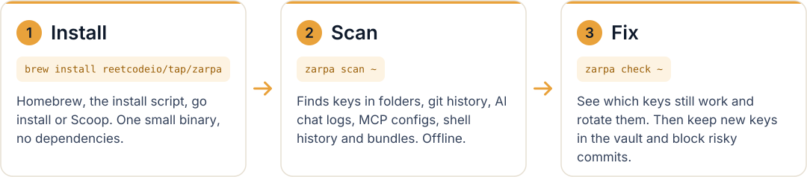
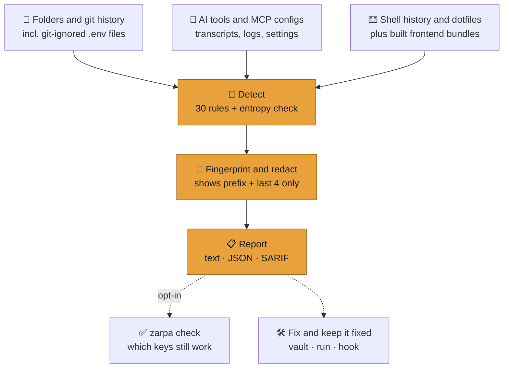

<div align="center">

<picture>
  <source media="(prefers-color-scheme: dark)" srcset="docs/assets/banner-dark.svg">
  
</picture>

### Find every API key on your machine, and see where each one leaked

AI coding tools copy keys into places nobody looks: chat transcripts, MCP configs, shell history.
Old keys live on in git history after you delete the file, and a `VITE_` variable quietly ships a
secret to every visitor's browser. Zarpa finds all of them with one command. It runs offline, and
raw keys never leave your machine.

[](https://github.com/Reetcodeio/zarpa/actions/workflows/ci.yml)
[](https://github.com/Reetcodeio/zarpa/releases/latest)
[](LICENSE)
[](go.mod)
[](https://github.com/Reetcodeio/zarpa/releases)
<br>
[](go.mod)
[](#privacy)
[](#privacy)
[](#install)

[Install](#install) · [Quick start](#quick-start) · [How it works](#how-it-works) · [What it finds](#what-it-finds) · [Commands](#command-reference) · [CI](#in-ci) · [FAQ](#faq)

</div>

<br>

<p align="center">
  
</p>

<p align="center"><sub>Every key above is fake. Run <code>make demo</code> to see the same report on a throwaway fake machine.</sub></p>

## Quick start

<picture>
  <source media="(prefers-color-scheme: dark)" srcset="docs/assets/steps-dark.svg">
  
</picture>

```sh
brew install reetcodeio/tap/zarpa
zarpa scan ~          # your home folder, AI tools, MCP configs, shell history
zarpa check ~         # which of those keys still work? (asks first)
```

A full home-folder scan of a developer Mac (309,775 files, 24 repos, 18,162 commits) takes about a
minute and a half.

## Install

```sh
# macOS or Linux, with Homebrew
brew install reetcodeio/tap/zarpa

# macOS or Linux, with the install script
curl -fsSL https://raw.githubusercontent.com/Reetcodeio/zarpa/main/install.sh | sh

# Windows, with Scoop
scoop bucket add zarpa https://github.com/Reetcodeio/scoop-bucket
scoop install zarpa

# Anywhere with Go 1.23+
go install github.com/Reetcodeio/zarpa/cmd/zarpa@latest
```

Or download an archive for macOS, Linux or Windows from [Releases](https://github.com/Reetcodeio/zarpa/releases).
The install script checks the download's SHA-256, and its cosign signature when `cosign` is installed.
It puts `zarpa` in `/usr/local/bin`; set `ZARPA_BIN_DIR=~/.local/bin` for somewhere else.

<details>
<summary><b>Downloaded the macOS archive in a browser?</b></summary>

<br>

The binary isn't notarized by Apple yet, so macOS blocks a copy downloaded in a browser. Use
Homebrew or the install script instead (neither is affected), or check the archive against
`checksums.txt` and then run:

```sh
xattr -d com.apple.quarantine ./zarpa
```

</details>

<details>
<summary><b>Verify a release download yourself</b></summary>

<br>

Every release ships `checksums.txt`, signed keylessly with [cosign](https://github.com/sigstore/cosign)
from this repo's release workflow, plus an SBOM for each archive.

```sh
cosign verify-blob \
  --certificate checksums.txt.pem --signature checksums.txt.sig \
  --certificate-identity-regexp '^https://github.com/Reetcodeio/zarpa/' \
  --certificate-oidc-issuer https://token.actions.githubusercontent.com \
  checksums.txt
shasum -a 256 -c checksums.txt --ignore-missing
```

</details>

## How it works



1. **Look everywhere keys end up.** Not just the folder you point at: Zarpa also knows where AI
   tools, MCP clients and shells keep their files on your machine, and reads every commit of every
   repo it finds.
2. **Detect.** 30 rules for specific providers, plus an entropy rule for random values next to
   key-like names.
3. **Fingerprint and redact.** Each key gets a fingerprint, `HMAC-SHA256(salt, key)`, so the same
   key found in five places is one finding with five locations. Only the provider prefix and the
   last 4 characters are ever shown.
4. **Report.** Sorted by severity, with what makes each key risky: shipped to the browser, only in
   git history, in a git-ignored file, or sitting in an AI transcript.
5. **Then act.** `zarpa check` tells you which keys still work, so you know what to rotate first.
   `vault`, `run` and `hook` keep it from happening again.

## What it finds

| Where | What Zarpa reads |
|---|---|
| 📁 **Folders you name** | Honors `.gitignore`, but still scans ignored `.env*`, `.envrc`, `.npmrc` and MCP config files and marks them, because that is where forgotten keys live. Skips dependency caches (`node_modules`, `.venv`, …) and binaries. |
| 🕘 **Git history** | Every line ever added on every branch of every repo found. Each finding points at the commit that introduced the key, even if the file is long gone. |
| 🤖 **AI tools** | Session transcripts, logs and shell snapshots of Claude Code, Codex, Gemini CLI, Cursor, Continue and Codeium, and the Claude desktop app's logs. |
| 🔌 **MCP and editor configs** | Claude Desktop, Claude Code (`~/.claude.json`, `.mcp.json`), Cursor, VS Code, Windsurf, Zed, Codex, Gemini CLI. |
| ⌨️ **Shell history and dotfiles** | zsh, bash, fish, Python and Node REPL history; `~/.zshrc`, `~/.netrc`, `~/.npmrc`, `~/.aws/credentials`, `~/.docker/config.json` and more. |
| 📦 **Built frontends** | `zarpa scan --bundle dist` flags every key that would ship to the browser. |

<details>
<summary><b>Supported keys: 30 rules</b> (run <code>zarpa rules</code> for IDs)</summary>

<br>

Severity is **high** unless marked.

| Provider | Keys |
|---|---|
| Anthropic | Admin API key (**critical**) · API key · other key types |
| OpenAI | Admin key (**critical**) · project key · service-account key · legacy key |
| Google | API key (Gemini, Maps, Firebase) · auth key (Gemini, new `AQ.` format) |
| Stripe | Live secret key (**critical**) · live restricted key · webhook signing secret (medium) · test secret key (low) |
| Supabase | Secret key (**critical**) · `service_role` JWT (**critical**) |
| AWS | Secret access key (**critical**) · access key ID |
| GitHub | Personal access token (classic) · fine-grained token · OAuth or app token |
| Slack | Token · incoming webhook URL (medium) |
| Twilio | API key SID (medium) |
| SendGrid · Hugging Face · Groq · xAI · OpenRouter | API keys and access tokens |
| Private keys | PEM blocks |
| Anything else | A high-entropy value next to a key-like name (medium) |

How rules work and how to add a provider: [docs/RULES.md](docs/RULES.md).

</details>

## Check which keys still work

```sh
zarpa check ~
```

It asks before sending anything, then makes one read-only request per key to the provider that
issued it and adds a STATUS column:

| STATUS | Meaning |
|---|---|
| `WORKS` | The provider accepted the key. Rotate it. |
| `dead` | The provider rejected it. |
| `?` | Network error or rate limit; try again later. |
| `-` | No safe read-only check exists for this key type. |

Keys found only in other people's commits are never tested. Supported: OpenAI, Anthropic, Google
(Gemini), Stripe, GitHub, Supabase `service_role`, Hugging Face, Groq, xAI, OpenRouter, Slack,
SendGrid.

## Fix it, and keep it fixed

| Problem | Fix |
|---|---|
| Keys sit in `.env` files | `zarpa vault import .env` moves them into the macOS Keychain (Linux: Secret Service), then `zarpa run -- npm run dev` starts your app with them as env vars. |
| A commit adds a key | `zarpa hook install` adds a pre-commit hook that scans only what you commit. |
| A build ships a key to the browser | Add `"postbuild": "zarpa scan --bundle dist"` to `package.json` (Next.js: `--bundle .next`). |
| A key leaks in a pull request | Run Zarpa in CI (below). |

```sh
zarpa vault import .env             # move a whole .env into the Keychain, then delete the .env
zarpa vault add OPENAI_API_KEY      # or one at a time (input hidden)
zarpa run -- npm run dev            # start the app with the vault keys as env vars
zarpa hook install                  # block commits that add a key (this repo)
```

`vault get NAME` prints a raw key only into a pipe or with `--reveal`, so keys don't end up in
terminal scrollback or AI tool logs. Bypass the hook once with `git commit --no-verify`; mark a
false positive with a `zarpa:allow` comment on that line.

### In CI

```yaml
- uses: actions/checkout@v5
  with:
    fetch-depth: 0              # full history, so old commits are scanned too
- name: Scan for leaked keys
  run: |
    curl -fsSL https://raw.githubusercontent.com/Reetcodeio/zarpa/main/install.sh | sh
    zarpa scan . --no-machine --sarif -o zarpa.sarif    # exit code 1 when keys are found
```

| Exit code | Meaning |
|---|---|
| 0 | No keys found (or `--exit-zero`) |
| 1 | Keys found |
| 2 | Error |

Other output formats: `--json`, `--sarif -o file`. Skip paths with a `.zarpaignore` file
(gitignore syntax) at the scan root.

## Command reference

| Command | What it does |
|---|---|
| `zarpa scan [path ...]` | Find keys in folders, git history, MCP configs, AI tool transcripts, shell history and dotfiles |
| `zarpa scan --bundle ./dist` | Find secret keys in a built frontend (they ship to browsers) |
| `zarpa check [path ...]` | Scan, then test which found keys still work |
| `zarpa vault add\|ls\|get\|rm\|import` | Keep keys in your OS keychain |
| `zarpa run -- <command>` | Start a command with vault keys as env vars |
| `zarpa hook install` | Block commits that add a key (this repo) |
| `zarpa rules` | List the detection rules |
| `zarpa version` | Print the version |
| `zarpa login` · `sync` · `panic` · `logout` | Zarpa Cloud commands ([not open yet](#zarpa-cloud-optional-paid-not-open-yet)) |

<details>
<summary><b>Scan flags</b> (<code>zarpa scan -h</code>; <code>check</code> takes the same)</summary>

<br>

With no path, `zarpa scan` scans the current folder. Machine sources (MCP configs, AI transcripts,
shell history, dotfiles) are always included unless `--no-machine`.

| Flag | Meaning |
|---|---|
| `-v` | List every location of every key |
| `--json` · `--sarif` · `--format text\|json\|sarif` | Output format (default `text`) |
| `-o FILE` | Write the report to a file instead of stdout |
| `--min-severity LEVEL` | Hide findings below `critical`, `high`, `medium` or `low` (default `low`) |
| `--bundle` | The paths are built frontend output (`dist/`, `build/`, `.next`): flag every key in them |
| `--staged` | Scan only changes staged for commit (used by the pre-commit hook) |
| `--check` | After scanning, test which keys still work |
| `--yes` | With `--check`: don't ask for confirmation |
| `--no-git` | Skip git history |
| `--max-commits N` | Newest commits to read per repo (`0` = all) |
| `--no-machine` | Skip MCP configs, AI transcripts, shell history and dotfiles |
| `--home DIR` | Home directory to scan for machine sources (default: yours) |
| `--max-file-mb N` | Largest regular file to read, in MB (default 5) |
| `--workers N` | Parallel scanners (default 2) |
| `--rules FILE` | Load detection rules from a JSON file |
| `--salt-file FILE` | Keep the fingerprint salt in this file instead of the keychain |
| `--exit-zero` | Exit 0 even when keys are found |
| `--no-color` · `-q` | No colors · no progress line |

</details>

<details>
<summary><b>Vault, run and hook</b></summary>

<br>

```text
zarpa vault add NAME          Store a key (paste it, or pipe it: pbpaste | zarpa vault add NAME)
zarpa vault import FILE       Store every KEY=value line of a .env file
zarpa vault ls                List stored names
zarpa vault get NAME          Print a key (only into a pipe, or with --reveal)
zarpa vault rm NAME           Delete a key

zarpa run [--only NAME,NAME] -- <command>

zarpa hook install [--force]  Block commits that add an API key (this repo)
zarpa hook uninstall          Remove the hook (restores any hook it replaced)
zarpa hook status             Show whether the hook is installed
```

Names are env var names, like `OPENAI_API_KEY`. `zarpa vault` isn't available on Windows yet.

</details>

<details>
<summary><b>JSON output</b></summary>

<br>

`zarpa scan --json` prints one object with `tool`, `version`, `rules_version`, `started_at`,
`stats` and `findings`. Each finding is one key, with every place it was found:

```json
{
  "fingerprint": "a192dc…",
  "provider": "stripe",
  "rule": "stripe-live-secret-key",
  "name": "Stripe live secret key",
  "severity": "critical",
  "display": "sk_live_…GmJf",
  "last4": "GmJf",
  "public_exposure": false,
  "history_only": false,
  "category": "leak",
  "locations": [
    { "kind": "file", "ref": "repo:shop:.env:2", "line": 2, "column": 19,
      "repo": "shop", "var": "STRIPE_SECRET_KEY", "git_ignored": true }
  ]
}
```

</details>

## Privacy

- **Offline.** `zarpa scan` makes no network calls. The only calls are `zarpa check`, after you
  confirm, and the optional cloud commands below.
- **No raw keys, ever.** Reports show the provider prefix and the last 4 characters. Nothing raw is
  printed, written or uploaded.
- **No telemetry.**
- **No dependencies.** Go standard library only; git history is read through your own `git`.

Each key is identified by a fingerprint, `HMAC-SHA256(salt, key)`, with a random salt kept in your
keychain. Details, and where in the code to check each claim: [docs/SECURITY.md](docs/SECURITY.md).

## FAQ

<details>
<summary><b>Does Zarpa send my keys anywhere?</b></summary>

<br>

No. `zarpa scan` makes no network calls at all. `zarpa check` sends each key only to the provider
that issued it, in one read-only request, and only after you say yes. The optional cloud commands
upload fingerprints and locations, never keys, and `zarpa sync --dry-run` shows exactly what would
be sent.

</details>

<details>
<summary><b>How is this different from gitleaks or TruffleHog?</b></summary>

<br>

Those are excellent at scanning repositories and their history, and they fit well in CI. Zarpa
scans repos and history too, but it is built for your whole machine: it knows where AI coding
tools, MCP clients and shells keep their files and scans them by default, flags keys that will
ship in a frontend bundle, and groups every copy of a key into one finding. Using both is fine.

</details>

<details>
<summary><b>It flagged something that isn't a key</b></summary>

<br>

Add a `zarpa:allow` comment on that line, or skip whole paths with a `.zarpaignore` file. Please
also [open an issue](https://github.com/Reetcodeio/zarpa/issues) with the rule ID and the shape of
the value, never the value itself.

</details>

<details>
<summary><b>It missed a key</b></summary>

<br>

Run `zarpa rules` to see whether the provider is covered, then open an issue describing the key
format (prefix and length), never with a real key in it. New rules need a positive and a negative
test; see [docs/RULES.md](docs/RULES.md).

</details>

<details>
<summary><b>Does it work on Windows?</b></summary>

<br>

Yes for `scan`, `check` and `hook` (install with Scoop or the `.zip` from Releases).
`zarpa vault` isn't available on Windows yet.

</details>

## Zarpa Cloud (optional, paid; not open yet)

The scanner tells you where keys are. Zarpa Cloud watches what they *spend*: it reads each key's
usage at Anthropic, OpenAI and Google, alerts you on spikes, and freezes a key automatically or
with one tap on your phone. If a tool you use is breached, `zarpa panic --tool <name>` freezes every
key it touched and gives you a checklist.

Zarpa Cloud is still being built; pre-order at **[zarpa.dev](https://zarpa.dev)**. Once it opens,
the scanner connects to it with:

```sh
zarpa login --api https://api.zarpa.dev   # paste a CLI token from the dashboard
zarpa sync ~ --dry-run                    # preview: fingerprints and locations, never keys
```

The scanner is free and works fully on its own.

## Star history

<a href="https://www.star-history.com/?repos=Reetcodeio%2Fzarpa&type=date&legend=top-left">
  <picture>
    <source media="(prefers-color-scheme: dark)" srcset="https://api.star-history.com/svg?repos=Reetcodeio/zarpa&type=Date&theme=dark">
    
  </picture>
</a>

## Contributing

Bug reports, false positives, missed keys and new provider rules are all welcome. Start with
[CONTRIBUTING.md](CONTRIBUTING.md); build and test with:

```sh
make build      # bin/zarpa
make test       # tests (make race: with the race detector)
make demo       # scan a fake machine full of fake keys
```

<a href="https://github.com/Reetcodeio/zarpa/graphs/contributors">
  
</a>

**Security issues:** please report them privately, not in a public issue. See
[docs/SECURITY.md](docs/SECURITY.md#reporting-a-vulnerability).

## License

Apache-2.0. See [LICENSE](LICENSE).
